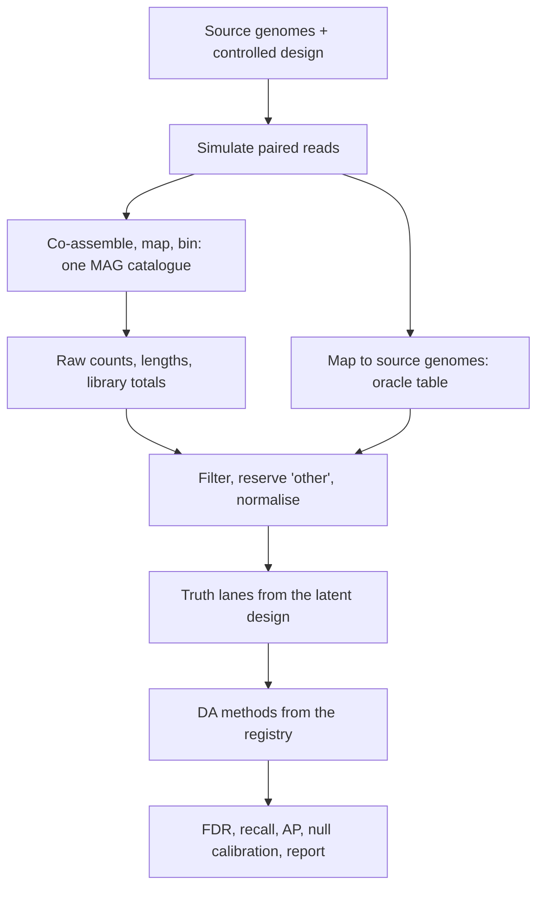
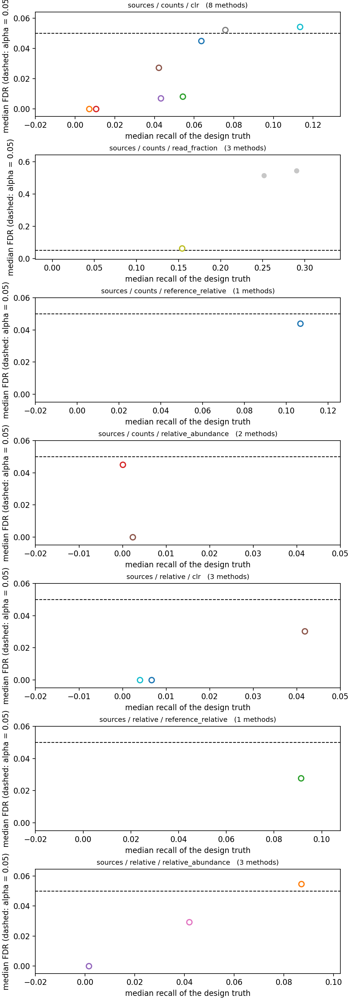
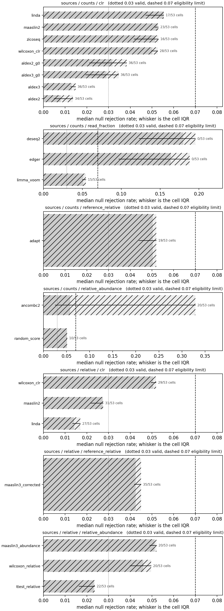
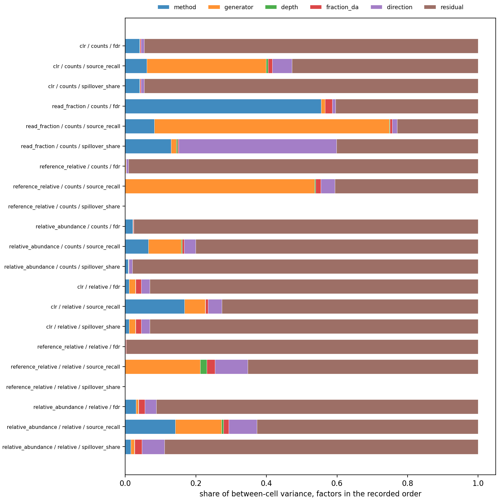
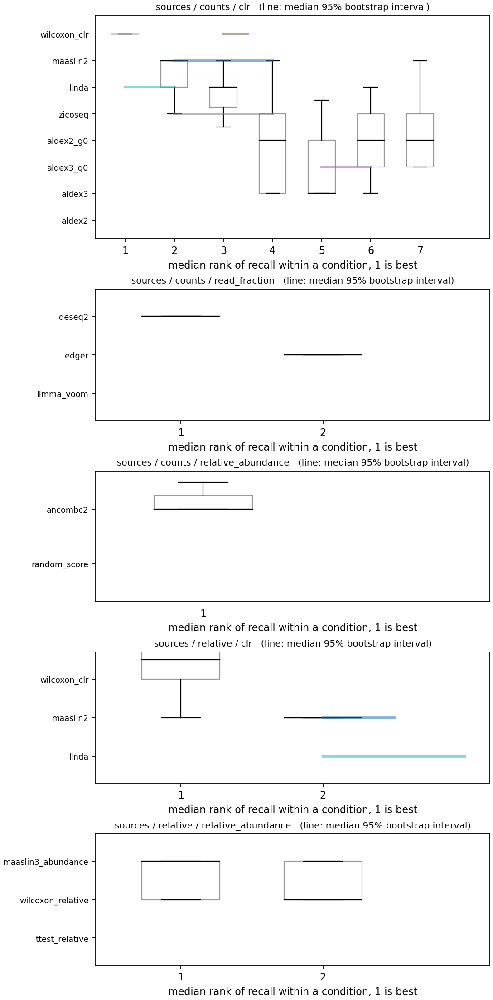
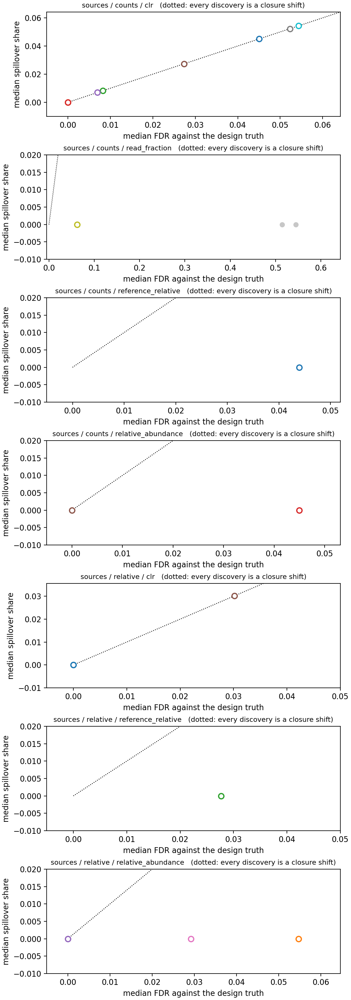

# MAGICIAN: differential abundance benchmarks on MAGs

**Current experiment:** the corrected `tier1-v3` protocol has been **run to completion**.
The protocol, validation and rerun procedure are recorded in
[docs/corrected_tier1.md](docs/corrected_tier1.md); the run outputs are under
`results_paper_tier1_v3/` and the measured summary, tables and figures below are generated
from them by `tools/readme_report.py`. Two earlier Tier 1 runs (original and `tier1-v2`)
were stopped after generator and scoring defects were confirmed, and their outputs were
deleted.

MAGICIAN tests whether differential abundance (DA) methods stay trustworthy when the
feature table comes from **metagenome-assembled genomes (MAGs)** instead of a clean
taxon table. It simulates communities with a known design, rebuilds a MAG catalogue,
runs the DA methods in the registry, and scores them against truth defined on the scale
each method actually tests.

## How it works



- **Truth lanes.** Each method is scored on its own endpoint: relative abundance, read
  fraction, CLR, change relative to a typical feature (reference-relative), or absolute
  abundance. A correct read-fraction association is not counted as a false positive.
- **Methods** live in [config/methods.yaml](config/methods.yaml) and run through small
  R adapters in `workflow/scripts/da/`. Variants (e.g. gamma settings) are grouped
  as one method family.
- **No silent wins.** Failed, empty or timed-out methods are recorded and cannot rank.
  A method with *exactly* zero recall cannot win by declaring nothing — but the rule
  has no minimum-effect-size bar, so a method with a negligible one can still take
  rank 1 when every competitor is ineligible. See the chance-baseline finding below.
- **Matrix-only mode** skips reads, assembly and binning, so many replicates are cheap.
- Sequencing intermediates are deleted after counting; only compact matrices and
  audit evidence are kept ([storage policy](docs/storage.md)).

## How to run

```bash
conda env create -n magician --file environment.yaml
conda activate magician
python tools/bootstrap_envs.py --all          # build and freeze method environments (needs network once)
pytest -q                                     # regression tests
python run_magician.py --dry-run              # check the workflow
python run_magician.py --cores 4              # 4-genome smoke test
```

| Goal | Command |
|---|---|
| 20-genome end-to-end pilot | `python run_magician.py --configfile config/pilot20.yaml --cores 8` |
| Matrix-only screening | `python tools/matrix_screening.py --designs baseline overdispersed low_count dropout --null-replicates 5 --spiked-replicates 5` then `python run_magician.py --configfile cache/calibration/config.yaml --cores 8` |
| Real genomes | `python tools/real_genomes.py check\|freeze ...`, then an overlay config ([production.yaml](config/production.yaml) is an example) |
| Tier 1 paper run | `python tools/paper_tier1.py --full --cores 16` |
| Tier 1 conditional analysis + figures | `python tools/paper_analysis.py --tier1 results_paper_tier1_v3/benchmark --out results_paper_tier1_v3/analysis` |
| Refresh the measured README section and figures | `python tools/readme_report.py` (add `--check` to fail when stale) |
| Cluster | `profiles/slurm` (needs the Snakemake SLURM plugin and your account settings) |

Results go to `results_*/benchmark/`; open `report.html` first. Key tables:
`ranking.tsv` (eligibility and rank), `scores.tsv` (per run), `recovery.tsv`
(source genomes recovered), `method_resources.tsv` (runtime, memory),
`recommendations.json`. The conditional analysis adds `analysis/` with
`rank_uncertainty.tsv`, `contrasts.tsv`, `variance.tsv`, `decision_guide.json`
and five figures under `analysis/figures/`.

## Tier 1 v3 results

The corrected `tier1-v3` protocol ran to completion on 2026-10-10 in matrix-only mode at
alpha 0.05: every workflow step completed and no method run failed, timed out or returned
an empty result.

All counts are **simulated matrices**. One generator resamples measured donor profiles and
the other two are synthetic models calibrated on the same donor table. No reads, assemblies
or MAGs were produced by this run, so nothing here is evidence about MAGs themselves.

<!-- BEGIN GENERATED: tier1-v3. Do not edit by hand; run tools/readme_report.py -->

*Generated from `results_paper_tier1_v3/` by `tools/readme_report.py`. Every value below is read from the run outputs; prose outside this block is hand-written.*

### Run summary

| Quantity | Value |
|---|---|
| Datasets evaluated | 4,060 |
| Method configurations | 18 |
| Workflow steps | 94,820 of 94,820 done |
| Failed / empty / timed-out runs | 0 / 0 / 0 |
| Measured job time | 1.53 M s (~426 core-hours) |
| Retained output | 32.9 GB of a 200 GB budget |
| Ranking rows eligible | 474 of 1,113 |

### Per-method medians

Medians across the design conditions of the run. `Eligible` counts conditions out of 53 where the preregistered rule is met. FDR and recall are against the implanted design truth; null rejection is the raw null p-value rate.

| Metric | Endpoint | Method | Eligible | Null reject | FDR | Recall |
|---|---|---|---|---|---|---|
| counts | clr | ALDEx2/3 (gamma 0) | 36 | 0.029-0.032 | 0.007-0.008 | 0.043-0.054 |
| counts | clr | ALDEx2/3 (gamma 0.5) | 34-36 | 0.008-0.013 | 0.000 | 0.007-0.010 |
| counts | clr | Wilcoxon-CLR | 28 | 0.050 | 0.027 | 0.042 |
| counts | clr | MaAsLin2 | 23 | 0.053 | 0.045 | 0.064 |
| counts | clr | LinDA | 17 | 0.055 | 0.054 | 0.113 |
| counts | clr | ZicoSeq | 16 | 0.051 | 0.052 | 0.076 |
| counts | read_fraction | limma-voom | 15 | 0.051 | 0.062 | 0.154 |
| counts | read_fraction | DESeq2 | 0 | 0.180 | 0.545 | 0.290 |
| counts | read_fraction | edgeR | 0 | 0.164 | 0.514 | 0.252 |
| counts | reference_relative | ADAPT | 19 | 0.050 | 0.044 | 0.107 |
| counts | relative_abundance | ANCOM-BC2 | 20 | 0.058 | 0.000 | 0.002 |
| counts | relative_abundance | random baseline | 10 | 0.051 | 0.045 | 0.000 |
| relative | clr | MaAsLin2 | 31 | 0.027 | 0.000 | 0.007 |
| relative | clr | Wilcoxon-CLR | 29 | 0.051 | 0.030 | 0.042 |
| relative | clr | LinDA | 27 | 0.014 | 0.000 | 0.004 |
| relative | reference_relative | MaAsLin3 corrected | 35 | 0.042 | 0.028 | 0.091 |
| relative | relative_abundance | t-test (relative) | 22 | 0.023 | 0.000 | 0.001 |
| relative | relative_abundance | MaAsLin3 abundance | 20 | 0.051 | 0.055 | 0.087 |
| relative | relative_abundance | Wilcoxon (relative) | 20 | 0.046 | 0.029 | 0.042 |

### Which method wins depends on the endpoint

No method sweeps. Over the eligible cells that have a rank-1 winner:

| Endpoint | Metric | Cells | Rank-1 winner |
|---|---|---|---|
| clr | counts | 37 | LinDA 17, Wilcoxon-CLR 9, ALDEx2/3 (gamma 0) 7, ZicoSeq 3, MaAsLin2 1 |
| clr | relative | 36 | Wilcoxon-CLR 29, MaAsLin2 5, LinDA 2 |
| read_fraction | counts | 15 | limma-voom 15 |
| reference_relative | counts | 19 | ADAPT 19 |
| reference_relative | relative | 35 | MaAsLin3 corrected 35 |
| relative_abundance | counts | 26 | ANCOM-BC2 20, random baseline 6 |
| relative_abundance | relative | 32 | Wilcoxon (relative) 17, MaAsLin3 abundance 9, t-test (relative) 6 |

### Figures



*Each panel is one endpoint and input metric; a filled marker is eligible in every condition it ran in, a hollow marker only in some, grey never. The dashed line is alpha.*



*Dotted is the conservative bound, dashed the eligibility limit; the whisker is the interquartile range of the null rate across conditions.*



*These depend on factor order and are not a fitted mixed-effects model.*



*The coloured line is the median 95% bootstrap interval.*



*Points on the dotted line would make no genuine error at all.*


### Findings

- **DESeq2 and edgeR fail the null check on the read-fraction endpoint.** Their median null rejection rates are 0.18 and 0.16 against a 0.07 limit, with spiked FDR 0.54 and 0.51. They are eligible in 0 of 53 and 0 of 53 conditions respectively. Their recall (0.29, 0.25) is bought almost entirely from false discoveries.
- **limma-voom is the only method calibrated on raw counts.** Null rejection 0.051, FDR 0.062, recall 0.154, eligible in 15 of 53 conditions.
- **Power, not error control, is the binding constraint.** The highest median recall across all methods is 0.29 (DESeq2); every other method sits below it. At the core effect size these methods largely cannot recover the implanted features, so the ranking is decided by error control and the sensitivity differences are mostly noise.
- **The CLR gamma setting still decides the answer.** ALDEx2/3 at gamma 0.5 reach a median recall of 0.009; at gamma 0 that rises to 0.049, about 6x, while FDR stays below 0.010. Rankings flip on that one parameter.
- **Compositional closure is not the main error source.** The largest `spillover_share` on any eligible row is 0.068, so most method error against the design truth is genuine error rather than real closure shifts misfiled as false positives.
- **The chance baseline is eligible, and sometimes ranks first.** random_score is a deliberately random ranker kept in the registry as a control. It clears the preregistered rule in 10 conditions and takes rank 1 in 6 of them. The rule's only quantitative bar above eligibility is *positive* recall, with no minimum effect size and no requirement to beat chance, so any 'best method' claim needs that added first.
- **Variance shares are descriptive.** They depend on factor order and are not a fitted mixed-effects model. Contrasts against the observed best method are exploratory, the consensus rule is specified but never evaluated, and batch confounding was not tested.

<!-- END GENERATED: tier1-v3 -->

**Verdict.** The pipeline ran end to end at full scale and the scoring behaves as designed:
failures stay visible rather than being scored as wins, and the analysis tables reproduce
byte-identically because the bootstrap is seeded. The findings are solid on **error
control** and weak on **sensitivity**. The one place the scoring misleads is the chance
baseline above, which is a gap in the eligibility rule rather than a flaw in the run.

The study that would turn this into a publishable comparison, with real genomes, real-data
nulls, read-level implants and cohort replication, is specified in [plan.md](plan.md).

## Historical pilot results

Superseded and retained only for provenance. These are from the original implementation,
before the generator and scoring defects that forced the `tier1-v2` withdrawal were fixed.
**They must not be used to establish method reliability.** In particular their recall
column is an artefact of labelling every non-zero shift as differential, and their null
"any-false-discovery" column is not the null rejection rate used in v3.

| Run | Scale | Outcome |
|---|---|---|
| Calibration | 40 matrix replicates (20 null, 20 spiked) over 4 designs, 16 methods | 964/964 jobs, no failures |
| Screening | 8 replicates, 2 designs | 100/100 jobs |
| Pilot20 | 20 genomes, 10 samples per group, full pipeline, 1 null + 1 spiked | 195/195 jobs |

Pilot calibration, source level (FDR on spiked cases, recall, null any-false-discovery rate):

| Endpoint | Method | FDR | Recall | Null any-FD | Eligible |
|---|---|---|---|---|---|
| CLR | ZicoSeq | 0.024 | 0.50 | 0.05 | yes |
| CLR | Wilcoxon-CLR | 0.028 | 0.50 | 0.00 | yes |
| CLR | ALDEx2 / ALDEx3 (gamma 0) | 0.004 | 0.50 | 0.00 | yes |
| CLR | MaAsLin2 | 0.037 | 0.50 | 0.00 | yes |
| CLR | ALDEx2 / ALDEx3 (gamma 0.5) | 0.00 | 0.00 / 0.14 | 0.00 | yes, but near-zero recall |
| CLR | LinDA | 0.028 | 0.50 | 0.10 | no |
| Read fraction | limma-voom | 0.029 | 0.50 | 0.05 | yes |
| Read fraction | DESeq2 | 0.288 | 0.52 | 0.40 | no |
| Read fraction | edgeR | 0.074 | 0.50 | 0.10 | no |
| Reference-relative | radEmu, ADAPT | 0.023, 0.033 | 0.50 | 0.00, 0.05 | yes |
| Reference-relative | MaAsLin3 corrected | 0.014 | 0.50 | 0.15 | no |
| Relative abundance | ANCOM-BC2 | 0.002 | 0.49 | 0.00 | yes |
| Relative abundance | MaAsLin3 abundance | 0.026 | 0.50 | 0.15 | no |

Pilot20 (one replicate per scenario) showed the same pattern: DESeq2 FDR 0.20, edgeR
0.25, everything else 0.00. LOCOM is excluded from the registry: its pinned package
fails on its own example data.

## Repository layout

```text
config/            Settings, method registry, zero policies, manifest examples
workflow/          Snakefile, rules, schemas, R/Python adapters, pinned environments
src/magician/      Testable scientific logic
profiles/          Local, SLURM and testing profiles
tools/             Environment bootstrap, matrix screening, genome manifests, README generator
tests/             Regression tests and R adapter validation
docs/              Methods, storage, validation record, extension plan, generated figures
plan.md            Experiment plan for the paper
```

Further reading: [validation record](docs/validation.md), [methods](docs/methods.md),
[extension plan](docs/extension_plan.md).
